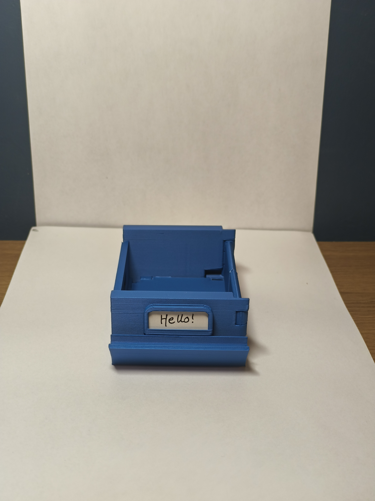
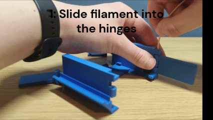
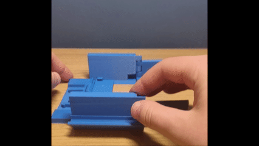
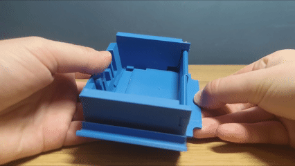
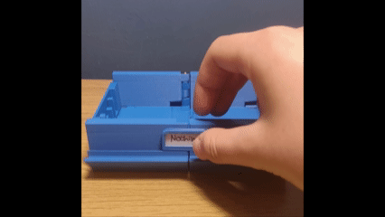
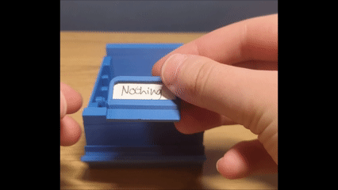

# Slide-lock-modular-drawers
3D printed modular drawers where the drawers themselves are actually modular. Each module can be a draw by itself, combine with another draw on either side, or combine with a draw on both sides. This means that you can make an infinitely wide draw!

# Demo
[This video](https://www.youtube.com/shorts/B5VZUPittGw?feature=share) is the easiest way to see what they do and learn how to use them

# Uses
Since the size of the draw you can make is very versatile, it has many different uses. Here are some things it could store:
- Current hardware projects - each project is different so needs a different amount of storage
- Electronics - the drawers are the perfect depth to fit any size up to AA batteries and cases for them, arduinos, perfboards, breadboards, etc
- Craft supplies
- Anything where temporary small storage is needed as they are so versatile

# 3D printing instructions
In a single module, there are 6 separate parts to print. One part - the label holder, isn't necessary to print if you don't want to put a label on the front of the draw. You can either:
- download the .3mf file which has all the parts in the correct orientation for 3D printing with the correct settings for Bambu studio
- Or download the .step files for each part, where you'll need to orient the parts and configure the settings yourself in a slicer (instructions below)

Use PLA or any other rigid filament of your choice

## Part orientation
Orient the parts as shown in the picture below. I have optimised the orientation so the parts are stronger and require fewer supports.

## Print settings
- Use automatically generated tree supports
- I recommend you use an outer brim for the Label holder, Front right side and Back right side parts
- If you think warping may be an issue, add an outer brim to the other parts as well
- 0.2mm layer height is suitable
- Standard wall loop and infill settings can be used as the parts don't need to be very strong

# Assembly instructions
Remove brims & supports, then:

**Assembly Complete!!**

# How to use
Either watch the video at the top, or watch these gifs:
### Closing draw

### Connecting two modules

### Separating modules

### Changing label

# Why I made the project
I made the project because I noticed that no one has made modular drawers where the actual drawers are modular - kind of ironic, right? Once I'd started thinking of the idea, I was also intrigued by the idea because I knew it'd be a bit of a challenge. I'm very happy with the solution that I've come up with, considering that it works very reliably and the draws feel surprisingly solid when connected. If possible, I'd like to slim the design down more, and I'm also planning on making a drawer cabinet/holder/shelves for them. 
